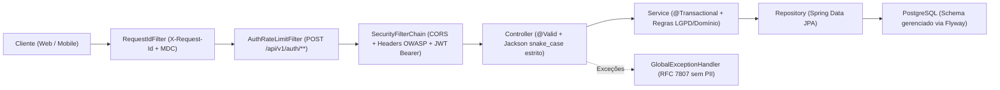

# 01 — Visão Geral e Como Funciona o Projeto

## 1. Propósito do CHAMA
O **CHAMA** é uma iniciativa social e educacional voltada a conectar jovens de escolas públicas e comunidades periféricas a oportunidades em tecnologia e inovação (cursos, mentorias, bolsas, eventos e vagas).

O repositório **`CHAMA_beckend`** é a API REST central da plataforma. Nesta fase inicial, ele entrega a base arquitetural segura, a persistência versionada em PostgreSQL e todo o ciclo de **cadastro, autenticação e sessão**.

---

## 2. Stack Tecnológica

| Camada | Tecnologia | Versão / Detalhe |
| :--- | :--- | :--- |
| Linguagem | Java | **25** (Records imutáveis, tipagem forte) |
| Framework Web & DI | Spring Boot | **4.2.0** (`webmvc`, `validation`, `actuator`) |
| Segurança | Spring Security + OAuth2 Resource Server | **7.2.0** (JWT HS256 + BCrypt custo 12) |
| Persistência | Spring Data JPA (Hibernate) | `ddl-auto=validate`, `open-in-view=false` |
| Migrações de Banco | Flyway | Versionamento SQL automático no startup |
| Banco de Dados | PostgreSQL | **16+ / 18** (H2 em modo PostgreSQL nos testes) |
| Build & Testes | Maven Wrapper (`./mvnw`) | JUnit 5, Mockito, MockMvc |

---

## 3. Arquitetura Monolítica Modular

O código em `src/main/java/com/chama/backend/` é dividido em **duas camadas principais** (conforme `ADR-001`):

1. **`core/` (Infraestrutura Transversal):**
   - Configurações globais validadas na subida (`core/config/`).
   - Cadeia de segurança HTTP, filtros, geração/validação de JWT (`core/security/`).
   - Tratamento centralizado de erros no padrão RFC 7807 simplificado (`core/exception/`).
   - **Regra:** o `core/` não deve conter regras de negócio de domínio específico.

2. **`modules/` (Domínios de Negócio Isolados):**
   - Cada domínio (`auth`, `user`, `health` e futuramente `school`, `opportunity`, `application`) possui subpacotes claros:
     - `controller/` — Recebe HTTP, valida entrada (`@Valid`) e delega ao service.
     - `dto/` — Contratos imutáveis (`record`) de entrada e saída em `snake_case`.
     - `service/` — Regras de negócio, validações de domínio e fronteiras transacionais (`@Transactional`).
     - `repository/` — Interfaces Spring Data JPA para acesso ao banco.
     - `model/` — Entidades JPA e enums de domínio.

---

## 4. Caminho de uma Requisição HTTP

Toda requisição passa por um pipeline determinístico de segurança e observabilidade antes de chegar às regras de negócio:

### Por que esse pipeline protege a aplicação?
- **Rastreabilidade sem PII:** `RequestIdFilter` gera ou sanitiza `X-Request-Id` no início da chamada e limpa o `MDC` no `finally`.
- **Proteção contra força bruta:** `AuthRateLimitFilter` limita tentativas por IP em rotas `POST /api/v1/auth/**`.
- **Anti-Mass Assignment:** Jackson está configurado com `fail-on-unknown-properties=true`, rejeitando imediatamente qualquer campo inesperado no JSON antes mesmo de chegar ao `Service`.
- **Schema previsível:** `spring.jpa.hibernate.ddl-auto=validate` impede que o Hibernate altere tabelas por conta própria; apenas o Flyway modifica o banco.
