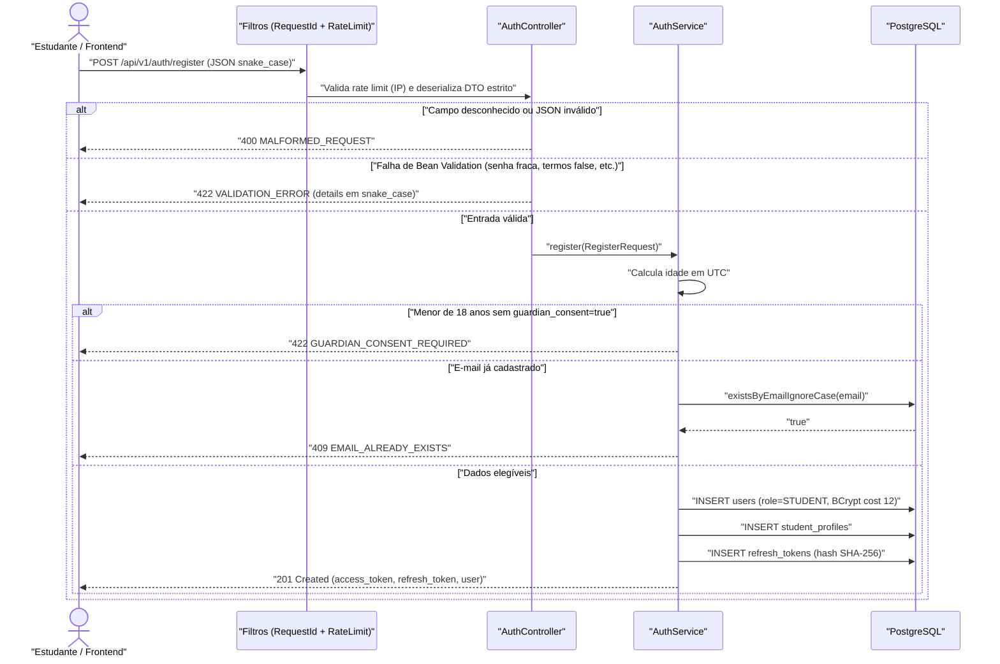
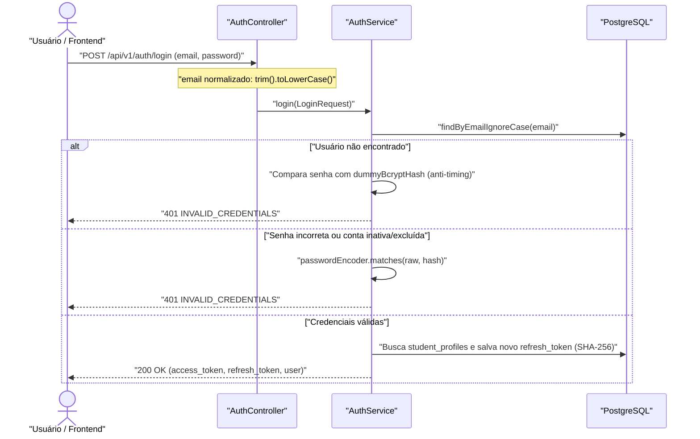
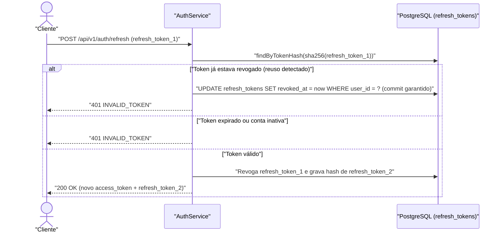

# 04 — Fluxos do Sistema

Este documento descreve como os principais fluxos da aplicação operam ponta a ponta.

---

## 1. Fluxo de Cadastro (`POST /api/v1/auth/register`)



---

## 2. Fluxo de Login (`POST /api/v1/auth/login`)



---

## 3. Fluxo de Acesso Autenticado (`GET /api/v1/auth/me`)

1. O cliente envia `Authorization: Bearer <access_token>`.
2. O `BearerTokenAuthenticationFilter` usa o `JwtDecoder` (`HS256`) para validar assinatura, expiração (`exp`) e emissor (`iss`).
3. O `JwtAuthenticationConverter` extrai a claim `role` e gera a autoridade Spring Security (`ROLE_STUDENT`, `ROLE_PARTNER` ou `ROLE_ADMIN`).
4. O `AuthController.me(@AuthenticationPrincipal Jwt jwt)` extrai o `sub` (UUID do usuário) e chama `AuthService.getCurrentUser(userId)`.
5. Se o token estiver ausente, adulterado ou expirado, o `AuthenticationEntryPoint` responde `401 UNAUTHORIZED` no envelope padrão `ApiErrorResponse`.

---

## 4. Fluxo de Rotação de Refresh Token, Detecção de Reuso e Logout



- **Logout (`POST /api/v1/auth/logout`):** calcula o hash `SHA-256` do `refresh_token` enviado, marca `revoked_at` se ainda ativo e devolve `204 No Content`.

---

## 5. Fluxo de Erros Padronizados e Rate Limit

- Toda exceção capturada pelo `GlobalExceptionHandler` ou pelos handlers do `SecurityConfig` devolve o mesmo formato JSON:
  ```json
  {
    "error": {
      "code": "VALIDATION_ERROR",
      "message": "Os dados enviados são inválidos.",
      "details": [
        { "field": "email", "issue": "Formato de e-mail inválido" }
      ],
      "request_id": "req_9f8e7d6c"
    }
  }
  ```
- Quando um IP ultrapassa o limite em `POST /api/v1/auth/**`, o `AuthRateLimitFilter` interrompe a requisição antes de chegar ao controller/banco, retornando `429 Too Many Requests`, header `Retry-After: 60` e código `RATE_LIMIT_EXCEEDED`.
