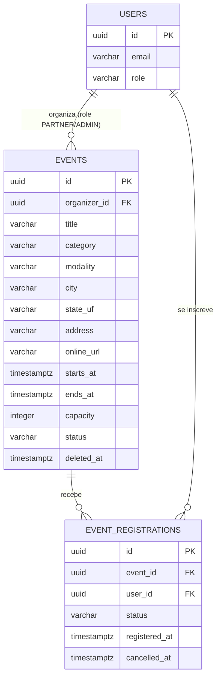

# Diagrama ER — Eventos e Inscrições

> Referenciado pela [Spec 06 — Modelo de Dados: Eventos](../specs/06-modelo-dados-eventos.md).
> Entidade `users` aparece resumida apenas para mostrar o relacionamento com `events`/
> `event_registrations` — detalhes completos estão na [Spec 03](../specs/03-modelo-dados.md).
> Veja também o [Diagrama UML de classes](./eventos-uml.md), com a visão das entidades Java/JPA.
>
> `city`/`state_uf` são colunas de texto em `events` (sem tabelas `states`/`cities` separadas —
> ver trade-off na Spec 06, seção 5).

## Leitura rápida das relações

- Um **usuário** com `role` `PARTNER` ou `ADMIN` organiza vários **eventos**.
- Um **evento** recebe várias **inscrições**; um **usuário** pode ter várias inscrições (em eventos
  diferentes), mas no máximo uma por evento (`UNIQUE (event_id, user_id)` em `event_registrations`).
- `city`/`state_uf` ficam direto em `events`, indexados juntos (`idx_events_state_uf_city`) para
  suportar o filtro "listar eventos por estado/cidade" sem precisar de JOIN.
