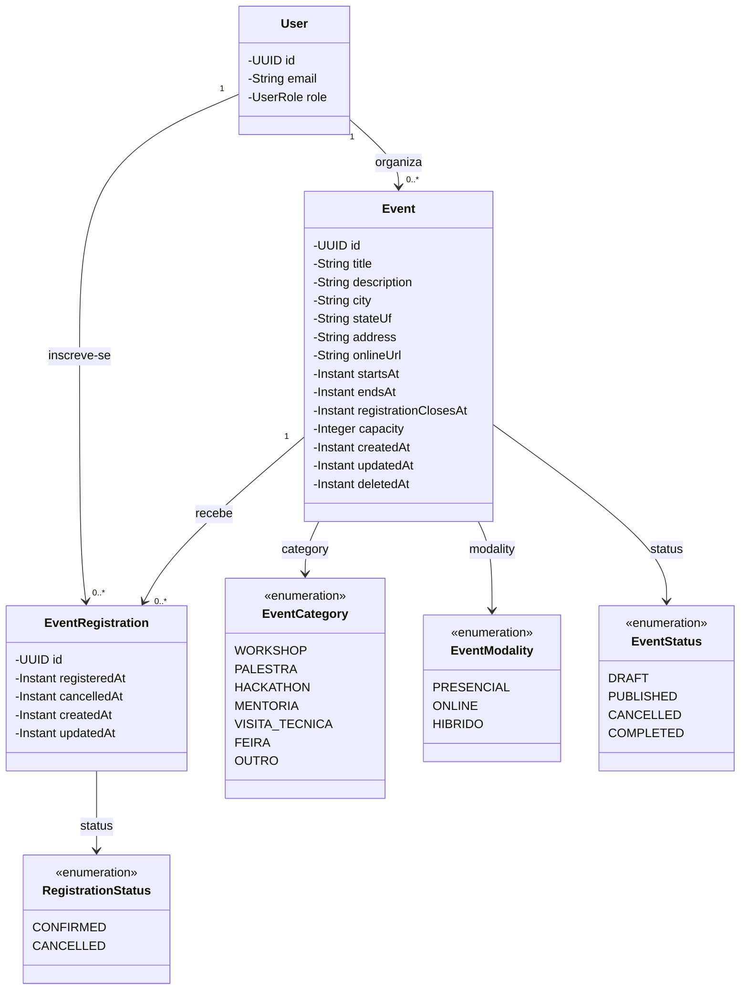

# Diagrama UML (Classes) — Eventos e Inscrições

> Complementa o [Diagrama ER](./eventos-er.md) (nível de tabela) com a visão de **classes de domínio
> Java/JPA** que serão criadas em `src/main/java/com/chama/backend/modules/`, seguindo o mesmo estilo
> de [`User.java`](../../src/main/java/com/chama/backend/modules/user/model/User.java) (campos
> privados, `UUID` gerado em `@PrePersist`, enums `@Enumerated(EnumType.STRING)`). Modelo de dados e
> decisões de negócio completos: [Spec 06](../specs/06-modelo-dados-eventos.md).

## Notas de leitura

- `city`/`stateUf` são atributos simples de texto em `Event` (sem classes `State`/`City` próprias) —
  mesma decisão de não normalizar explicada na [Spec 06](../specs/06-modelo-dados-eventos.md#5-por-que-não-normalizar-em-statescities-trade-off).
- `User` não é redesenhado por completo aqui — é a mesma entidade da
  [Spec 03](../specs/03-modelo-dados.md); só os campos relevantes para o domínio de eventos aparecem.
- Getters/setters e os construtores (`protected` sem args para o Hibernate + construtor público com os
  campos obrigatórios) foram omitidos do diagrama para focar em atributos e relacionamentos — seguem o
  mesmo padrão de `User.java`.
